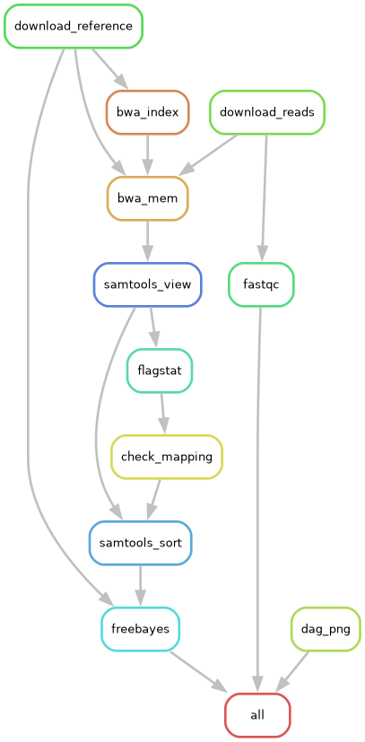

# Домашнее задание 3 - Пайплайн получения генетических вариантов

**Студент:** Шелестов Кирилл, группа **23213**
**НГУ, 2026**

Пайплайн скачивает прочтения _E. coli_ K-12 из NCBI SRA, выравнивает их на референсный
геном, оценивает качество картирования по алгоритму из блок-схемы задания
и, если качество достаточное, находит генетические варианты (VCF).

Алгоритм реализован в **двух версиях**:

1. **bash-скрипт** (`pipeline.sh`) - последовательная процедурная реализация;
2. **фреймворк Snakemake** (`Snakefile`) - декларативная реализация в виде графа
   зависимостей между файлами.

Обе версии на одних и тех же данных дают одинаковый вердикт: **OK** (93.89 % картировано),
варианты успешно вызваны.

| | |
| --- | --- |
| **Данные (риды)** | [SRR2584863](https://www.ncbi.nlm.nih.gov/sra/SRR2584863) - _Escherichia coli_ str. K-12 substr. MG1655, Illumina paired-end, WGS, NCBI SRA |
| **Референсный геном** | [GCF_000005845.2](https://www.ncbi.nlm.nih.gov/datasets/genome/GCF_000005845.2/) - _E. coli_ K-12 MG1655 (контиг `NC_000913.3`) |

---

## Содержание (по пунктам задания)

1. [Ссылка на загруженные прочтения из NCBI SRA](#1-ссылка-на-загруженные-прочтения-из-ncbi-sra)
2. [Bash-скрипт с реализованным алгоритмом](#2-bash-скрипт-с-реализованным-алгоритмом)
3. [Результат команды `samtools flagstat`](#3-результат-команды-samtools-flagstat)
4. [Скрипт разбора файлов с результатами](#4-скрипт-разбора-файлов-с-результатами)
5. [Файлы результатов (FASTQ / SAM / BAM / VCF)](#5-файлы-результатов-fastq--sam--bam--vcf)
6. [Инструкция по развёртыванию и установке фреймворка](#6-инструкция-по-развёртыванию-и-установке-фреймворка)
7. [Код тестового пайплайна «Hello world» на фреймворке](#7-код-тестового-пайплайна-hello-world-на-фреймворке)
8. [Результаты «Hello world» и лог-файлы](#8-результаты-hello-world-и-лог-файлы)
9. [Код пайплайна «оценки качества картирования» на фреймворке](#9-код-пайплайна-оценки-качества-картирования-на-фреймворке)
10. [Результаты работы пайплайна на загруженных данных](#10-результаты-работы-пайплайна-на-загруженных-данных)
11. [Лог-файлы работы пайплайна](#11-лог-файлы-работы-пайплайна)
12. [Визуализация пайплайна (DAG)](#12-визуализация-пайплайна-dag)
13. [Описание визуализации и отличия от блок-схемы алгоритма](#13-описание-визуализации-и-отличия-от-блок-схемы-алгоритма)

---

## Инструменты

| Программа | Источник | Назначение |
| --------- | ----------------- | ------------------------ |
| FastQC    | conda bioconda    | контроль качества ридов  |
| BWA       | conda bioconda    | выравнивание на референс |
| samtools  | conda bioconda    | работа с SAM/BAM, `flagstat` |
| FreeBayes | conda bioconda    | вызов вариантов (variant calling) |
| SRA Tools | conda bioconda    | скачивание ридов с NCBI (`prefetch`, `fasterq-dump`) |
| Snakemake | conda conda-forge | фреймворк пайплайнов     |
| Graphviz  | conda conda-forge | визуализация DAG (`dot`) |

---

## 1. Ссылка на загруженные прочтения из NCBI SRA

- **Прочтения:** <https://www.ncbi.nlm.nih.gov/sra/SRR2584863> - _E. coli_ K-12 MG1655, Illumina paired-end.
- **Референсный геном:** <https://www.ncbi.nlm.nih.gov/datasets/genome/GCF_000005845.2/> - _E. coli_ K-12 MG1655, `NC_000913.3`.

Команды для повторного скачивания ридов (через SRA Tools):

```bash
prefetch SRR2584863 --output-directory data/
fasterq-dump data/SRR2584863/SRR2584863.sra --outdir data/ --threads 4 --split-files
gzip data/SRR2584863_1.fastq data/SRR2584863_2.fastq
```

Референс скачивается с FTP NCBI:

```bash
wget -O ref/ecoli_k12.fa.gz \
  https://ftp.ncbi.nlm.nih.gov/genomes/all/GCF/000/005/845/GCF_000005845.2_ASM584v2/GCF_000005845.2_ASM584v2_genomic.fna.gz
gunzip ref/ecoli_k12.fa.gz && mv ref/ecoli_k12.fa.gz ref/ecoli_k12.fa
```

---

## 2. Bash-скрипт с реализованным алгоритмом

[`pipeline.sh`](pipeline.sh) - полная bash-реализация алгоритма «оценка качества картирования»
из блок-схемы задания. Скрипт последовательно выполняет шаги:

1. **Скачивание ридов** с NCBI SRA (`prefetch` + `fasterq-dump`);
2. **Скачивание референса** _E. coli_ K-12;
3. **FastQC** - контроль качества прочтений (с переименованием отчётов в `*_QC-report.html`);
4. **Индексирование** референса (`bwa index`);
5. **Картирование** ридов на референс (`bwa mem`) → SAM;
6. **SAM → BAM** + сортировка и индексирование (`samtools view | samtools sort`, `samtools index`);
7. **`samtools flagstat`** - статистика выравнивания;
8. **Оценка качества картирования** - разбор % mapped и ветвление **OK / not OK** по порогу 90 %;
9. при **OK** - сортировка BAM и **вызов вариантов** (`freebayes`) → VCF; при **not OK** - пайплайн останавливается.

Скрипт устойчив к повторным запускам (шаги пропускаются, если файлы уже существуют),
ведёт цветной журнал и сквозной лог-файл `logs/pipeline_<дата_время>.log`.

Запуск:

```bash
chmod +x pipeline.sh
./pipeline.sh
```

Итоговый вывод на загруженных данных:

```
✓ Mapping quality: OK (93.89% > 90%)
[INFO]  Пайплайн завершён успешно!
```

---

## 3. Результат команды `samtools flagstat`

Сырой вывод `samtools flagstat`, полученный при прогоне пайплайна на загруженных данных -
[`results/SRR2584863.flagstat.txt`](results/SRR2584863.flagstat.txt):

```
3131061 + 0 in total (QC-passed reads + QC-failed reads)
3106518 + 0 primary
0 + 0 secondary
24543 + 0 supplementary
0 + 0 duplicates
0 + 0 primary duplicates
2939902 + 0 mapped (93.89% : N/A)
2915359 + 0 primary mapped (93.85% : N/A)
3106518 + 0 paired in sequencing
1553259 + 0 read1
1553259 + 0 read2
2796762 + 0 properly paired (90.03% : N/A)
2874714 + 0 with itself and mate mapped
40645 + 0 singletons (1.31% : N/A)
0 + 0 with mate mapped to a different chr
0 + 0 with mate mapped to a different chr (mapQ>=5)
```

Ключевая цифра - **2 939 902 рида картировано, 93.89 %** (строка `mapped`). Это **выше** порога 90 %,
поэтому вердикт - **OK**, и пайплайн переходит к вызову вариантов.

---

## 4. Скрипт разбора файлов с результатами

[`scripts/parse_flagstat.py`](scripts/parse_flagstat.py) - отдельный самостоятельный скрипт на Python.
Принимает на вход файл с выводом `samtools flagstat`, регулярными выражениями разбирает все строки
вида `N + N <метрика> (XX.XX% : N/A)`, извлекает процент картированных ридов и сравнивает его с порогом.

Один и тот же скрипт переиспользуется и из bash-версии, и из Snakemake-версии (правило `check_mapping`) -
то есть логика разбора едина для обеих реализаций алгоритма.

Варианты запуска:

```bash
python3 scripts/parse_flagstat.py results/SRR2584863.flagstat.txt
python3 scripts/parse_flagstat.py results/SRR2584863.flagstat.txt --threshold 90
python3 scripts/parse_flagstat.py results/SRR2584863.flagstat.txt --json
```

Результат разбора сохраняется в [`results/SRR2584863.mapping_status.txt`](results/SRR2584863.mapping_status.txt):

```
  % картированных ридов: 93.89%
  Порог:                 90.0%

  ✓ Mapping quality: OK
```

---

## 5. Файлы результатов (FASTQ / SAM / BAM / VCF)

Файлы результатов лежат в каталоге `results/` (и `data/`, `ref/` для входных данных).

> **Важно:** большие бинарные файлы (`*.fastq.gz`, `*.sam`, `*.bam`, индексы референса) исключены
> из репозитория через [`.gitignore`](.gitignore), так как весят сотни МБ / ГБ и легко
> воспроизводятся повторным запуском пайплайна. В репозитории оставлены лёгкие итоговые артефакты:

| Файл | Что это |
| --- | --- |
| [`results/SRR2584863.flagstat.txt`](results/SRR2584863.flagstat.txt) | статистика выравнивания (`samtools flagstat`) |
| [`results/SRR2584863.mapping_status.txt`](results/SRR2584863.mapping_status.txt) | вердикт оценки качества: **OK** |
| [`results/SRR2584863.vcf`](results/SRR2584863.vcf) | найденные генетические варианты (**52 049** записей) |
| [`results/fastqc_SRR2584863/`](results/fastqc_SRR2584863/) | QC-отчёты FastQC (HTML + zip) для R1 и R2 |
| [`results/dag.png`](results/dag.png) | граф пайплайна (DAG) |
| [`logs/`](logs/) | логи каждого шага |

Фрагмент итогового VCF ([`results/SRR2584863.vcf`](results/SRR2584863.vcf)):

```
#CHROM      POS  ID  REF            ALT          QUAL     FILTER  INFO            ...
NC_000913.3 301  .   CTTTTTTTTTCGA  CTTTTTTTTCGA 2415.46  .       ...TYPE=del     ...
NC_000913.3 393  .   T              G            1907.68  .       ...TYPE=snp     ...
```

---

## 6. Инструкция по развёртыванию и установке фреймворка

В качестве фреймворка выбран **Snakemake** - современный стандарт для воспроизводимых
биоинформатических пайплайнов. Модель «правило (`rule`): выходные файлы собираются из входных
+ команда» позволяет Snakemake **автоматически** вывести порядок выполнения и запускать
независимые шаги параллельно, а также **инкрементально** пересобирать только устаревшие цели.

### Шаг 1 - установить conda

```bash
wget https://repo.anaconda.com/miniconda/Miniconda3-latest-Linux-x86_64.sh
bash Miniconda3-latest-Linux-x86_64.sh
```

### Шаг 2 - создать окружение со всеми программами

```bash
conda create -n hw3 -c bioconda -c conda-forge \
    fastqc bwa samtools freebayes sra-tools snakemake graphviz -y
conda activate hw3
```

### Шаг 3 - проверить установку

```bash
snakemake --version
fastqc --version; bwa 2>&1 | head -3; samtools --version | head -1; freebayes --version
```

### Основные команды Snakemake

```bash
snakemake --cores 4              # запустить весь пайплайн на 4 ядрах
snakemake --dry-run              # «сухой прогон»: план без выполнения
snakemake --forceall --cores 4   # принудительно перезапустить все шаги
```

---

## 7. Код тестового пайплайна «Hello world» на фреймворке

[`hello_world/Snakefile`](hello_world/Snakefile) - минимальный пайплайн из трёх правил,
демонстрирующий модель Snakemake «output собирается из input + shell-команда» и цепочку
зависимостей `hello → world → goodbye`:

```python
rule all:
    input: "results/goodbye.txt"

rule hello:
    output: "results/hello.txt"
    shell: 'echo "Hello, Snakemake World!" > {output}'

rule world:
    input: "results/hello.txt"
    output: "results/world.txt"
    shell: 'cat {input} > {output}'

rule goodbye:
    input: "results/hello.txt", "results/world.txt"
    output: "results/goodbye.txt"
    shell: """
        echo "=== Hello World Pipeline ===" > {output}
        cat {input} >> {output}
        echo "=== Pipeline finished! ===" >> {output}
        cat {output}
    """
```

Запуск:

```bash
cd hello_world
snakemake --cores 1
cd ..
```

---

## 8. Результаты «Hello world» и лог-файлы

Пайплайн реально запущен (`snakemake` в каталоге `hello_world/`), результат -
файл [`hello_world/results/goodbye.txt`](hello_world/results/goodbye.txt):

```
=== Hello World Pipeline ===
Hello, Snakemake World!
Hello, Snakemake World!
=== Pipeline finished! ===
```

Промежуточные файлы - `hello_world/results/hello.txt` и `hello_world/results/world.txt`.

---

## 9. Код пайплайна «оценки качества картирования» на фреймворке

[`Snakefile`](Snakefile) - тот же алгоритм из п. 2, переписанный **декларативно** как граф
файловых зависимостей. Параметры вынесены в [`config.yaml`](config.yaml):

```yaml
sample: "SRR2584863"
reference: "ref/ecoli_k12.fa"
reference_url: "https://ftp.ncbi.nlm.nih.gov/.../GCF_000005845.2_..._genomic.fna.gz"
threads: 4
mapped_threshold: 90
```

Правила и их роль:

| Правило (`rule`) | Делает | Вход → Выход |
| --- | --- | --- |
| `download_reads` | скачивает риды с SRA | - → `data/*.fastq.gz` |
| `download_reference` | скачивает референс с FTP NCBI | - → `ref/ecoli_k12.fa` |
| `fastqc` | контроль качества | `*.fastq.gz` → `*_QC-report.html` |
| `bwa_index` | индексирует референс | `ref.fa` → `ref.fa.{amb,ann,bwt,pac,sa}` |
| `bwa_mem` | картирование | риды + индекс → `*.sam` |
| `samtools_view` | SAM→BAM, sort, index | `*.sam` → `*.bam` (+`.bai`) |
| `flagstat` | статистика | `*.bam` → `*.flagstat.txt` |
| `check_mapping` | **оценка OK/not OK** | `*.flagstat.txt` → `*.mapping_status.txt` |
| `samtools_sort` | сортировка для FreeBayes | `*.bam` + статус → `*.sorted.bam` |
| `freebayes` | вызов вариантов | `*.sorted.bam` → `*.vcf` |
| `dag_png` | визуализация графа | - → `results/dag.png` |

**Ветвление OK / not OK** нельзя выразить статической структурой графа (это решение по данным,
возникающее только во время выполнения). Поэтому в правиле `check_mapping` оно реализовано как
обычная shell-проверка: скрипт `parse_flagstat.py` пишет вердикт, и если это **не** «OK» -
правило завершается с ошибкой (`exit 1`) и **останавливает весь пайплайн**, не давая дойти до
сортировки и FreeBayes. Именно так алгоритмическое условие «% mapped > 90 %?» встроено в
декларативный граф.

Запуск:

```bash
snakemake --cores 4
```

---

## 10. Результаты работы пайплайна на загруженных данных

Пайплайн на Snakemake реально прогнан (`snakemake --cores 4`), результаты в `results/`:

- [`SRR2584863.flagstat.txt`](results/SRR2584863.flagstat.txt) - отчёт `samtools flagstat`, **93.89 % mapped** (п. 3);
- [`SRR2584863.mapping_status.txt`](results/SRR2584863.mapping_status.txt) - вердикт **OK** (п. 4);
- [`SRR2584863.vcf`](results/SRR2584863.vcf) - итоговый VCF, **52 049 вариантов** (п. 5);
- [`results/fastqc_SRR2584863/`](results/fastqc_SRR2584863/) - QC-отчёты FastQC для R1 и R2.

Поскольку % картированных ридов (93.89 %) **выше** порога 90 %, вердикт - **OK**, и пайплайн
корректно прошёл до конца, включая вызов вариантов. Совпадение результатов bash- и
Snakemake-реализаций на одних и тех же входных данных подтверждает, что обе версии алгоритма
работают идентично и воспроизводимо.

---

## 11. Лог-файлы работы пайплайна

- `logs/` - логи каждого шага и сквозные журналы прогонов:
  - `pipeline_<дата_время>.log` - сквозной журнал bash-версии (по шагам);
  - `snakemake_pipeline.log` - журнал прогона Snakemake-версии;
  - отдельные логи инструментов задаются директивой `log:` в каждом правиле `Snakefile`
    (`logs/download_reference.log`, `logs/bwa_index.log`, `logs/bwa_mem_*.log`,
    `logs/samtools_view_*.log`, `logs/flagstat_*.log`, `logs/sort_*.log`,
    `logs/freebayes_*.log` и т. д.).

---

## 12. Визуализация пайплайна (DAG)

Snakemake умеет автоматически строить граф зависимостей. DAG построен командой:

```bash
snakemake --forceall --rulegraph | dot -Tpng > results/dag.png
```

Флаг `--rulegraph` выводит граф **правил** в формате DOT, `--forceall` гарантирует, что в граф
попадут **все** шаги (а не только незавершённые), а `dot` (из пакета Graphviz) рендерит его в PNG.
В самом пайплайне это вынесено в отдельное правило `dag_png`.

Получившийся DAG ([`results/dag.png`](results/dag.png)):



На графе видно, как `download_reads` и `bwa_index` сходятся в `bwa_mem`, далее идёт цепочка
`samtools_view → flagstat → check_mapping → samtools_sort → freebayes`, а ветка `fastqc`
(контроль качества) выполняется **параллельно** основной ветке картирования.

---

## 13. Описание визуализации и отличия от блок-схемы алгоритма

**Как построена визуализация.** Snakemake сам анализирует объявленные в каждом правиле
`input`/`output` и строит ориентированный ациклический граф (DAG) зависимостей между правилами,
после чего выводит его в формате Graphviz DOT, а `dot` рендерит в PNG. Ручной разбор текста
пайплайна не нужен - граф вычисляется автоматически из структуры `Snakefile`.

**Чем DAG принципиально отличается от блок-схемы алгоритма:**

| | DAG (Snakemake) | Блок-схема алгоритма |
| ------------------------ | ------------------------------------------- | ---------------------------------------- |
| **Узлы** | правила (`rule`) - преобразования данных | шаги: действия, условия, циклы |
| **Рёбра** | зависимости по файлам (`input`/`output`) | поток управления (что после чего) |
| **Ветвление по данным** | **не выражается** структурой графа | явное `if/else` (`% mapped > 90 %?`) |
| **Циклы** | отсутствуют (граф ацикличен - «A» в DAG) | возможны (`while`, `for`) |
| **Параллелизм** | виден явно: независимые ветки идут разом | не показан, схема линейна |
| **Что задаётся вручную** | только зависимости между файлами | весь порядок шагов и все условия |

**Главное отличие - ветвление по данным.** Блок-схема явно содержит ромб-условие
`% mapped > 90 % → Yes/No`, решение которого зависит от данных, появляющихся только во время
выполнения. DAG же строится **статически до запуска** и такое условие выразить не может: граф
показывает лишь «для VCF нужен файл со статусом картирования», но не «и статус должен быть OK».
Поэтому в `Snakefile` условие OK/not OK реализовано не структурой графа, а shell-проверкой внутри
правила `check_mapping` (см. п. 9): при «not OK» правило завершается с ошибкой и обрывает пайплайн.
На картинке ребро `check_mapping → samtools_sort` присутствует безусловно - сама логика «продолжать
ли» спрятана в рецепте и на графе не отображается.

**Гранулярность.** Блок-схема укрупняет шаги (например, `samtools view` - один блок и для конвертации,
и для сортировки). В DAG же каждый промежуточный файл - отдельный узел, поэтому видны и служебные
артефакты (индексы `.bai`, цель `all`, правило `dag_png`), которых в блок-схеме алгоритма нет вовсе:
для логики они несущественны, а для сборки по файлам необходимы.

---

## Итог

Алгоритм оценки качества картирования реализован в **двух версиях** - bash-скрипт (`pipeline.sh`)
и фреймворк **Snakemake** (`Snakefile`). На данных `SRR2584863` (_E. coli_ K-12) обе версии
дали одинаковый вердикт: **OK** (93.89 % картировано > 90 %), после чего корректно вызваны
генетические варианты - **52 049** записей в итоговом VCF. Результаты воспроизводимы и совпадают
между двумя реализациями.
